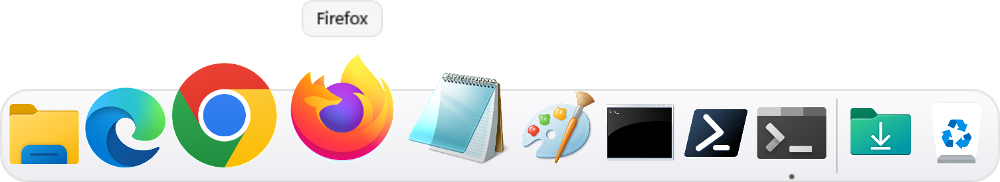

# Beanotch Dock

The Mac dock, right on Windows 10 and 11.



- Icons that grow as the pointer passes, with the app's name above
- Your taskbar's pinned apps, plus a dot under every app that's open
- Click to bring an app forward; one that isn't open starts with a bounce
- Downloads and the Recycle Bin at the end (drop files on the bin to throw them away)
- Auto-hide, three sizes, light and dark
- Windows' own taskbar hides itself while the dock runs, and comes back as it was when you quit or uninstall

Website: https://giankbr.github.io/beanotch-dock

## Install

Download `BeanotchDock-Setup-x64.exe` (or `-arm64.exe` on Snapdragon PCs) from [Releases](https://github.com/giankbr/beanotch-dock/releases/latest). The installer isn't signed yet: in SmartScreen choose More info › Run anyway. It installs for your account only, no admin prompt.

Right-click an empty part of the dock for its settings, or an app for its menu.

## Build

C# and WinUI 3 (.NET 8), unpackaged, no XAML.

```
dotnet publish src/BeanotchDock/BeanotchDock.csproj -c Release -r win-x64 -p:Platform=x64 -o out/BeanotchDock
iscc /DAppVersion=0.1.0 /DArch=x64 installer\BeanotchDock.iss
```

CI builds both architectures on every push, photographs the dock on a Windows runner, and attaches the installers to each release.

## Credits

How the Windows shell works was learned from [ManagedShell](https://github.com/cairoshell/ManagedShell), [Cairo Desktop](https://github.com/cairoshell/cairoshell) and [RetroBar](https://github.com/dremin/RetroBar) (Apache-2.0), and ideas from [Seelen UI](https://github.com/eythaann/Seelen-UI). The code here is written from scratch.

From the maker of [Beanotch](https://giankbr.github.io/beanie-notch), the notch dashboard for Mac and Windows.
