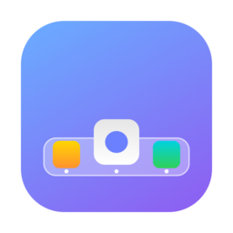
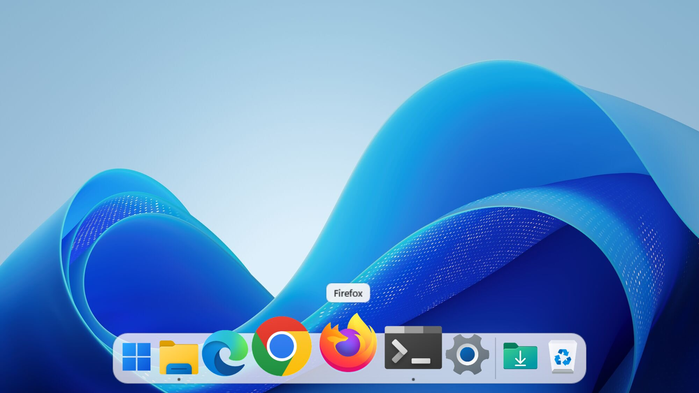
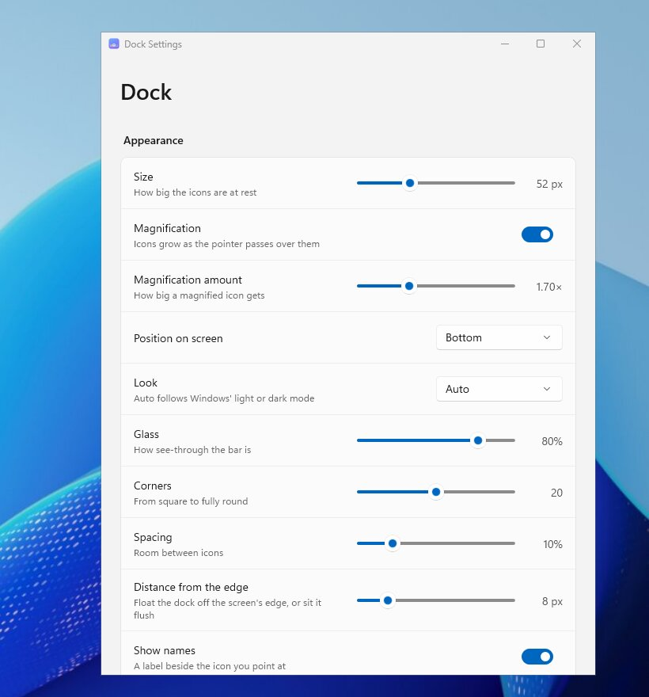
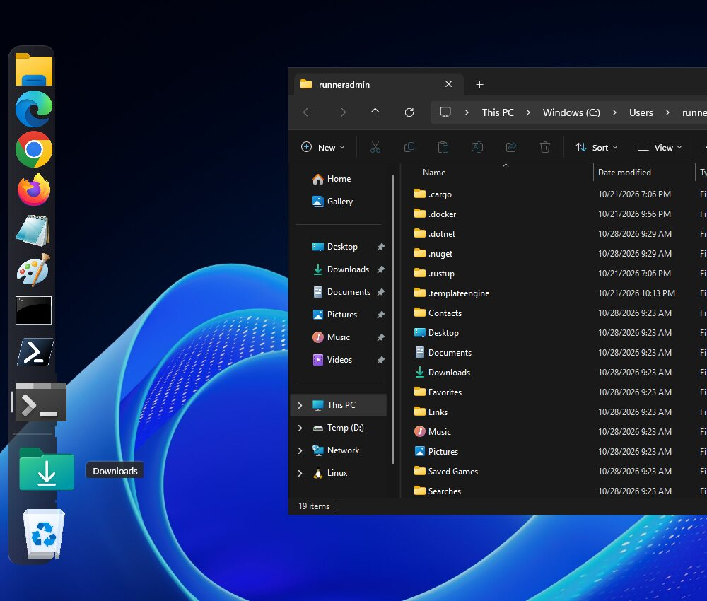

<p align="center">
  
</p>

<h1 align="center">Beanotch Dock</h1>

<p align="center">
  The Mac dock, right on Windows 10 and 11.<br>
  <a href="https://giankbr.github.io/beanotch-dock"><b>Website</b></a> ·
  <a href="https://github.com/giankbr/beanotch-dock/releases/latest"><b>Download</b></a> ·
  <a href="https://github.com/giankbr/beanotch-dock/issues">Report an issue</a>
</p>

<p align="center">
  <a href="https://github.com/giankbr/beanotch-dock/releases/latest"></a>
  <a href="https://github.com/giankbr/beanotch-dock/actions/workflows/build.yml"></a>
  
  
</p>

<p align="center">
  
</p>

## What it does

- **Magnification:** icons grow as the pointer glides past, with the app's name above the one you point at.
- **Your apps:** starts with the apps pinned to your taskbar; open apps show too, with a dot under each.
- **Click like a Mac:** an open app comes to the front, restored if minimized; one that isn't open starts with a bounce.
- **Start, Downloads and the Recycle Bin:** Start at the head; Downloads and the bin at the end. Drop files on the bin to throw them away, or on an app to open them there.
- **Mac tiles:** every app on a rounded square tinted from its own colours, or as Windows draws it.
- **Your own icons:** right-click an app › Options › **Change Icon…** for any PNG, ICO or JPEG.
- **Any edge:** bottom, left or right, with auto-hide. Icons shrink to fit when you keep more than the screen has room for.
- **Out of the way:** hides itself while a game, a video or a slideshow fills the screen.
- **The taskbar steps aside:** Windows' taskbar hides itself while the dock runs, and comes back exactly as it was when you quit or uninstall.
- **Updates itself:** new versions install on their own; the dock is back a few seconds later.

## Make it yours

Right-click the dock › **Dock Settings…** (or open Beanotch Dock again from Start). Everything applies as you change it.

| | |
|---|---|
| **Appearance** | Icon size · Mac tiles or original icons · magnification and how much · position (bottom, left, right) · light, dark or follow Windows · how see-through the glass is · corners · spacing · distance from the edge · names on hover · a dot, a line or nothing under open apps |
| **Behaviour** | Auto-hide and how long it waits · bounce when an app opens · open apps you haven't kept · click the app in front to minimize it · hide in full screen |
| **Items** | Start button · Downloads · Recycle Bin · the divider · the order of your kept apps |
| **System** | Hide the Windows taskbar · open at sign-in · update automatically · reset to defaults |

<p align="center">
  
  
</p>

Right-click an app for its windows, **Keep in Dock**, **Remove from Dock**, **Show in File Explorer** and **Quit**.

## Install

1. Download **`BeanotchDock-Setup-x64.exe`** from [Releases](https://github.com/giankbr/beanotch-dock/releases/latest), or **`-arm64.exe`** on a Snapdragon PC.
2. The installer isn't code-signed yet: in the SmartScreen window choose **More info › Run anyway**.
3. It installs for your account only, with no admin prompt, and the dock appears along the bottom of the screen.

To remove it, uninstall **Beanotch Dock** from Settings › Apps. Your taskbar goes back to how it was.

## FAQ

**Does it replace the taskbar?** It sits in its place. The taskbar is set to hide itself, so Start, the clock and the tray are still a nudge of the pointer to the bottom edge away. Turn off *Hide the Windows taskbar* to keep both.

**How do I get my taskbar back?** Quit the dock from its menu, or uninstall it. Either way the taskbar is restored as it was.

**Several screens?** The dock lives on your main screen for now.

**Does it send anything anywhere?** No. Its only network call is to GitHub, to look for new versions.

## Build

C# and WinUI 3 on .NET 8, unpackaged, the UI written in code (no XAML).

```powershell
dotnet publish src/BeanotchDock/BeanotchDock.csproj -c Release -r win-x64 -p:Platform=x64 -o out/BeanotchDock
iscc /DAppVersion=0.6.1 /DArch=x64 installer\BeanotchDock.iss
```

CI ([build.yml](.github/workflows/build.yml)) builds x64 and ARM64 on every push, photographs the dock on a Windows runner (light and dark, at rest, magnified, its menu and settings), and attaches both installers to each release.

```
src/BeanotchDock/
  DockWindow.cs       the see-through, click-through strip and what clicks, drops and menus do
  Ui/DockView.cs      layout and drawing: magnification, labels, marks, bounce, any edge
  SettingsWindow.cs   Dock Settings
  Services/           open windows, icons, the shell (launch, activate, Recycle Bin), taskbar, updates
```

## Credits

How the Windows shell works was learned from [ManagedShell](https://github.com/cairoshell/ManagedShell), [Cairo Desktop](https://github.com/cairoshell/cairoshell) and [RetroBar](https://github.com/dremin/RetroBar) (Apache-2.0); the see-through window follows [WinUIEx](https://github.com/dotMorten/WinUIEx)'s transparent backdrop (MIT); ideas from [Seelen UI](https://github.com/eythaann/Seelen-UI). The code here is written from scratch.

From the maker of [**Beanotch**](https://giankbr.github.io/beanie-notch), the notch dashboard for Mac and Windows. If the dock makes your PC feel a little more like home, [a tip](https://yapp.ink/gian) keeps the beans roasting.
